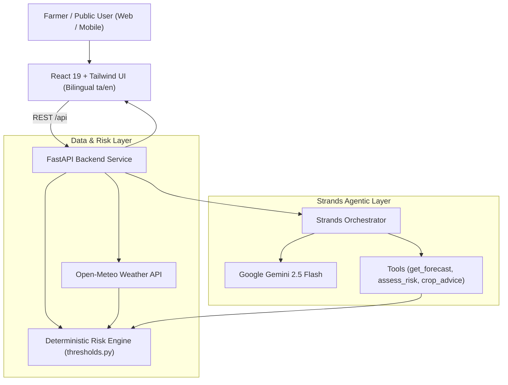
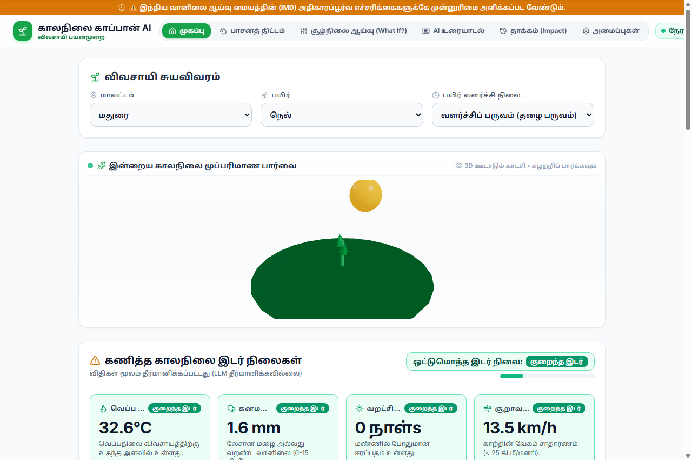
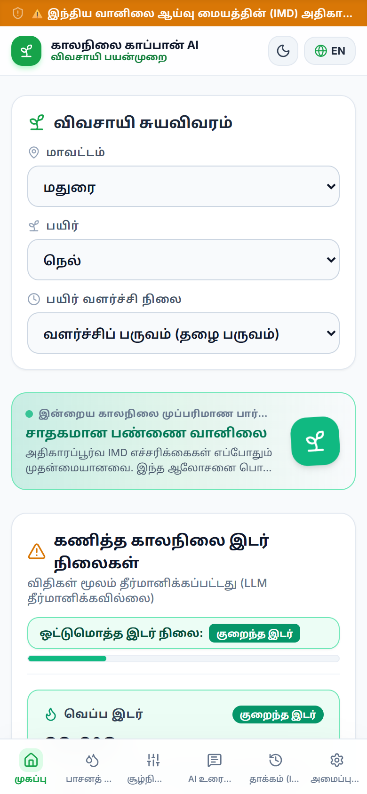
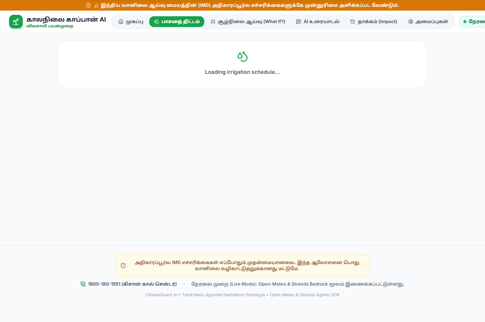
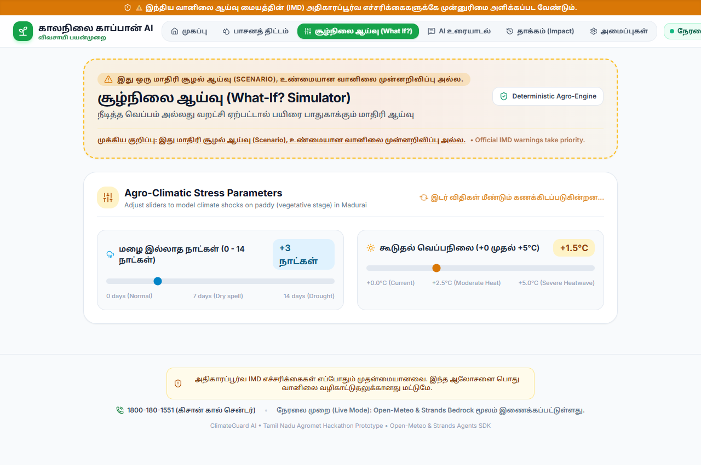

# ClimateGuard AI 🌾🌦️
> **Bilingual Climate Early-Warning & Agro-Advisory Agent for Tamil Nadu Farmers**  
> *தமிழ்நாடு விவசாயிகளுக்கான இருமொழி காலநிலை முன்னெச்சரிக்கை மற்றும் வழிகாட்டல் தளம்*

[](https://opensource.org/licenses/MIT)
[](https://www.python.org/)
[](https://fastapi.tiangolo.com/)
[](https://react.dev/)
[](https://tailwindcss.com/)
[](https://github.com/strands-ai/strands)

---

## 📌 Overview

**ClimateGuard AI** is a hyper-local, climate early-warning and decision-support system designed specifically for Tamil Nadu's agricultural communities. It bridges the gap between raw meteorological data and on-the-ground farming actions through **deterministic risk computation**, official IMD warning priority, and an interactive **Strands AI Agent** powered by Google Gemini.

Available completely in **Tamil (தமிழ்)** and **English**, the platform serves both **Farmers** (crop-specific hazard mitigation, spray windows, irrigation planning) and the **General Public** (heatwave, heavy rain, and storm safety advisories).

---

## ✨ Key Features

### 1. 🌾 Deterministic Agro-Climatic Risk Engine
- **Zero-Hallucination Risk Calculations**: Hazards are never estimated by LLMs. Threshold evaluations for heat stress, excess rainfall, dry spells, and wind gusting run through verified agronomic rules (`backend/config/thresholds.py`).
- **Official IMD Priority Notice**: Official India Meteorological Department (IMD) alerts always take precedent.
- **Foliar Spray Advisory**: Computes safe spray windows based on wind speed (< 15 km/h) and rainfall probability without prescribing unverified chemicals.

### 2. 🤖 Strands AI Agent (Gemini 2.5 Flash + Tool Calling)
- Powered by the **Strands Agents SDK** with `GeminiModel(model_id="gemini-2.5-flash")`.
- Orchestrates multi-step reasoning tools:
  - `get_forecast`: 7-day meteorological forecast from Open-Meteo.
  - `assess_risk`: Deterministic hazard evaluation.
  - `crop_advice`: Crop and stage-specific actions (Paddy, Banana, Cotton, Sugarcane, Groundnut, Maize, Vegetables).
  - `daily_farm_brief`: Concise 3-point operational summaries.
- Transparent execution with **Live Agent / Mock Mode badges** and collapsible **tool-call trace inspection**.

### 3. 💧 7-Day Irrigation Schedule
- Integrates FAO Penman-Monteith reference evapotranspiration (ET0) and anticipated rainfall.
- Computes daily recommendations: **Irrigate**, **Skip**, or **Light Irrigation** with clear visual charts.

### 4. 🔮 "What If?" Climate Scenario Simulator
- Interactive parametric stress-testing:
  - Simulate drought scenarios (`0` to `+14` consecutive dry days).
  - Simulate heat spikes (`+0°C` to `+5°C` temperature elevation).
- Real-time recalculation of composite hazard ratings with clear disclaimer: *"Scenario, not a forecast"*.

### 5. 🛡️ Dual-Persona Support (Farmer & Public Safety)
- **Farmer Mode**: Focuses on crop protection, irrigation scheduling, spraying windows, and field drainage.
- **Public Mode**: Focuses on community safety, vulnerable population guidance (children, elderly), and nearby emergency shelters/relief camps.

### 6. 🎨 Responsive Glass UI & 3D Weather Hero
- **Adaptive Navigation**: Sticky blurred glass navbar on desktop; bottom navigation tab bar with touch targets on mobile.
- **Interactive 3D Visualizer**: Lightweight Three.js + React Three Fiber scene reflecting the day's dominant hazard (sun shimmer, rain particles, wind turbulence) with 2D fallback.

---

## 🏗️ Architecture



---

## 📁 Repository Structure

```text
whether/
├── backend/
│   ├── agent/                # Strands agent orchestrator & tool definitions
│   │   ├── models.py         # Pydantic schemas & AgentTrace
│   │   ├── orchestrator.py   # Primary Gemini orchestrator & keyword router
│   │   ├── specialists.py    # Agricultural prompt engineering
│   │   └── tools.py          # Strands tool-calling interfaces
│   ├── config/
│   │   ├── settings.py       # Pydantic BaseSettings & .env loader
│   │   └── thresholds.py     # Deterministic risk & irrigation rules
│   ├── data/                 # TN districts, crops, and emergency places
│   ├── services/
│   │   ├── risk_engine.py    # Hazard evaluation engine
│   │   └── weather_service.py# Open-Meteo asynchronous & sync client
│   └── main.py               # FastAPI application entrypoint
│
├── frontend/
│   ├── src/
│   │   ├── components/       # UI Components (3D Scene, Chat, Irrigation, WhatIf)
│   │   ├── context/          # Language (ta/en) & Dark Theme contexts
│   │   ├── locales/          # Localization dictionaries (en.json, ta.json)
│   │   ├── App.jsx           # Root application controller
│   │   └── main.jsx          # React DOM entrypoint
│   ├── package.json
│   └── vite.config.js
│
├── .gitignore
└── README.md
```

---

## 🚀 Getting Started

### Prerequisites
- **Python 3.11+**
- **Node.js 18+** & npm
- *(Optional)* **Google Gemini API Key** for live LLM agent (mock mode runs automatically without key)

---

### 1. Backend Setup

```bash
# Navigate to backend
cd backend

# Create virtual environment
python -m venv .venv
source .venv/bin/activate  # On Windows: .venv\Scripts\activate

# Install dependencies
pip install -r requirements.txt  # Or: uv pip install fastapi uvicorn pydantic httpx strands-agents google-genai

# Configure environment
cp .env.example .env  # Add your GOOGLE_API_KEY if available

# Start backend server
uvicorn backend.main:app --host 127.0.0.1 --port 8000 --reload
```

Backend will be available at: `http://127.0.0.1:8000` (API Docs at `/docs`).

---

### 2. Frontend Setup

```bash
# Navigate to frontend
cd frontend

# Install packages
npm install

# Start Vite development server
npm run dev
```

Frontend will be available at: `http://127.0.0.1:5173`.

---

## ⚙️ Environment Variables (`backend/.env`)

```ini
ENVIRONMENT=development
PORT=8000
MOCK_MODE=false
MODEL_PROVIDER=google
GOOGLE_API_KEY=your_gemini_api_key_here
```

---

## 📱 Screenshots

| Desktop Dashboard | Mobile View |
| :---: | :---: |
|  |  |

| Irrigation Schedule | What If? Simulator |
| :---: | :---: |
|  |  |

---

## 📄 License

This project is licensed under the MIT License - see the LICENSE file for details.

---

## 👤 Author

Developed by **[SELVA-MEENAKSHI-K](https://github.com/SELVA-MEENAKSHI-K)**  
*ClimateGuard AI — Protecting livelihoods through intelligent early warning.*
