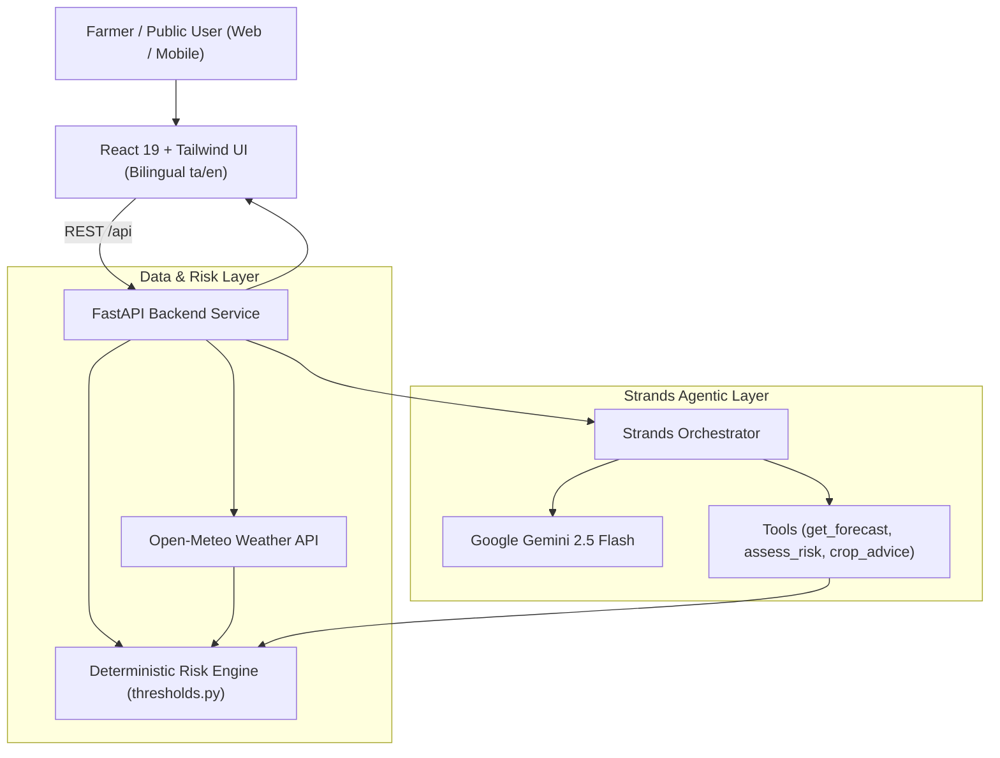
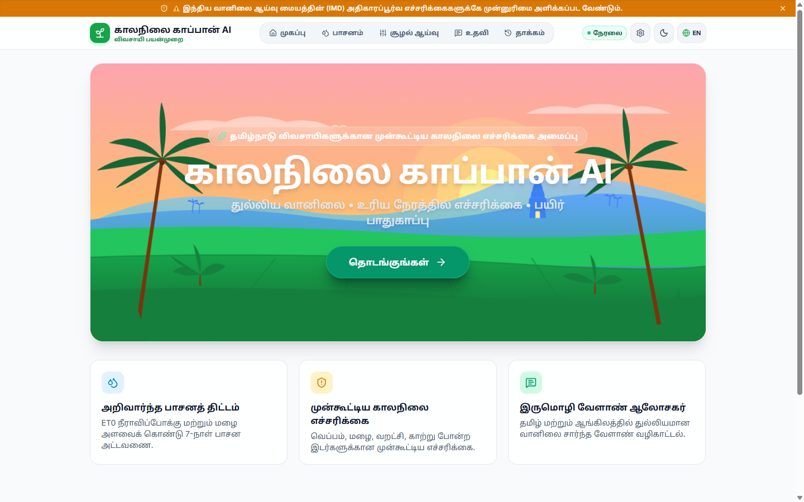
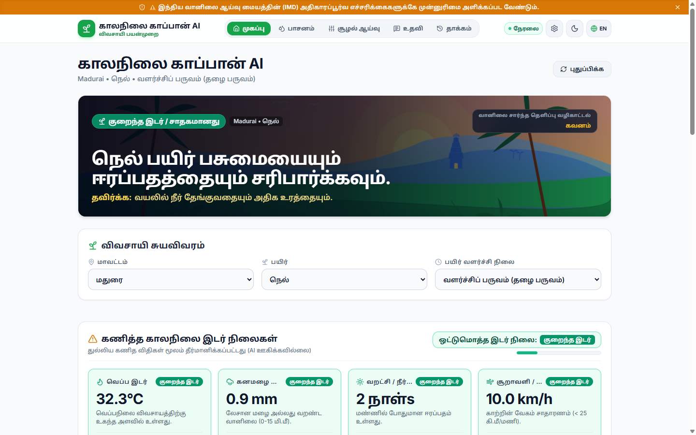
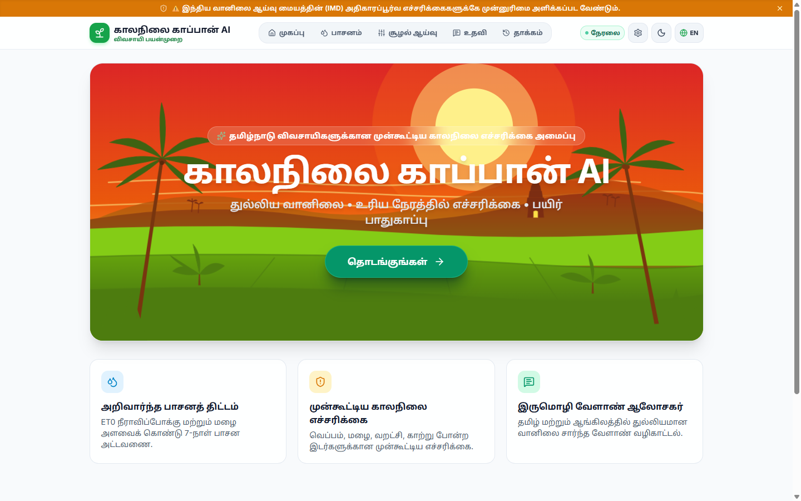
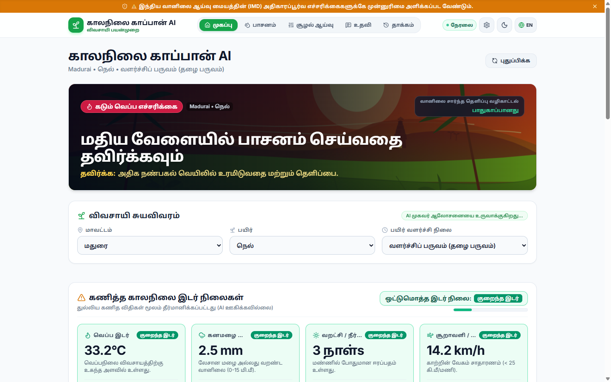
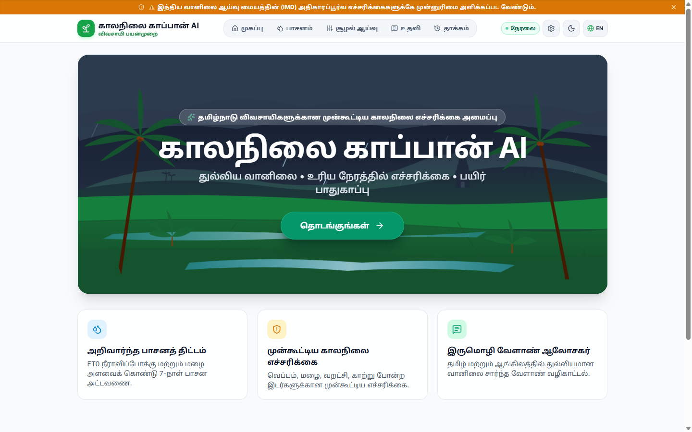
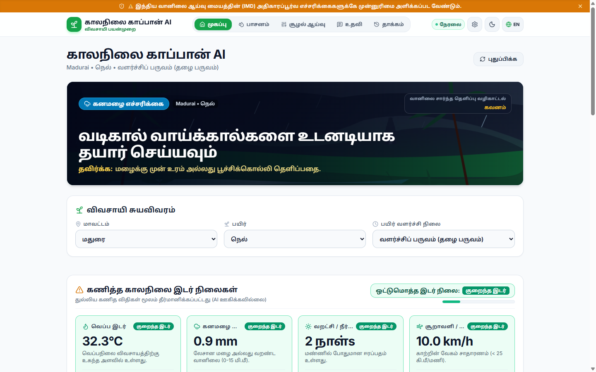

# ClimateGuard AI 🌾🌦️
> **Bilingual Climate Early-Warning & Agro-Advisory Agent for Tamil Nadu Farmers**  
> *தமிழ்நாடு விவசாயிகளுக்கான இருமொழி காலநிலை முன்னெச்சரிக்கை மற்றும் வழிகாட்டல் தளம்*

[](https://opensource.org/licenses/MIT)
[](https://www.python.org/)
[](https://fastapi.tiangolo.com/)
[](https://react.dev/)
[](https://tailwindcss.com/)
[](https://github.com/strands-ai/strands)

---

## 📌 Overview

**ClimateGuard AI** is a hyper-local, climate early-warning and decision-support system designed specifically for Tamil Nadu's agricultural communities. It bridges the gap between raw meteorological data and on-the-ground farming actions through **deterministic risk computation**, official IMD warning priority, and an interactive **Strands AI Agent** powered by Google Gemini.

Available completely in **Tamil (தமிழ்)** and **English**, the platform serves both **Farmers** (crop-specific hazard mitigation, spray windows, irrigation planning) and the **General Public** (heatwave, heavy rain, and storm safety advisories).

---

## ✨ Key Features

### 1. 🌾 Deterministic Agro-Climatic Risk Engine
- **Zero-Hallucination Risk Calculations**: Hazards are never estimated by LLMs. Threshold evaluations for heat stress, excess rainfall, dry spells, and wind gusting run through verified agronomic rules (`backend/config/thresholds.py`).
- **Official IMD Priority Notice**: Official India Meteorological Department (IMD) alerts always take precedent.
- **Foliar Spray Advisory**: Computes safe spray windows based on wind speed (< 15 km/h) and rainfall probability without prescribing unverified chemical dosages.

### 2. 🤖 Strands AI Agent (Gemini 2.5 Flash + Tool Calling)
- Powered by the **Strands Agents SDK** with `GeminiModel(model_id="gemini-2.5-flash")`.
- Orchestrates multi-step reasoning tools:
  - `get_forecast`: 7-day meteorological forecast from Open-Meteo.
  - `assess_risk`: Deterministic hazard evaluation.
  - `crop_advice`: Crop and stage-specific actions (Paddy, Banana, Cotton, Sugarcane, Groundnut, Maize, Vegetables).
  - `daily_farm_brief`: Concise 3-point operational summaries.
- Transparent execution with **Live Agent (Gemini) / Mock Mode badges** and collapsible **tool-call trace inspection**.

### 3. 💧 7-Day Smart Irrigation Schedule
- Integrates FAO-56 Penman-Monteith reference evapotranspiration (ET0) and anticipated rainfall.
- Computes daily recommendations: **Irrigate**, **Skip**, or **Light Irrigation** with clear visual charts and corrected net moisture balance (`Rain - ET0`).

### 4. 🔮 "What If?" Climate Scenario Simulator
- Interactive parametric stress-testing:
  - Simulate drought scenarios (`0` to `+14` consecutive dry days).
  - Simulate heat spikes (`+0°C` to `+5°C` temperature elevation).
- Real-time recalculation of composite hazard ratings with clear disclaimer: *"Scenario, not a forecast"*.

### 5. 🛡️ Dual-Persona Support (Farmer & Public Safety)
- **Farmer Mode**: Focuses on crop protection, irrigation scheduling, spraying windows, and field drainage.
- **Public Mode**: Focuses on community safety, vulnerable population guidance (children, elderly), and nearby emergency shelters/relief camps.

### 6. 🎨 Illustrated Vector Landscape Scene (<WeatherScene />)
- **Pure Vector Artwork (Inline SVG)**: Stylized Tamil Nadu landscape featuring layered Western Ghats hills, authentic temple Gopuram silhouette, terraced paddy fields with water reflections, swaying coconut palms, and banana plants.
- **Dynamic Hazard States**: Adapts palette and atmosphere for **Low (Sunrise)**, **Extreme Heat (Shimmer waves)**, **Heavy Rain (Animated streaks & flooded fields)**, **Drought (Cracked soil)**, and **Wind (Gust lines)**.
- **Accessible & Responsive**: WCAG AA compliant contrast scrim, min 32px Tamil typography, tab-visibility pause, and `prefers-reduced-motion` compliance.

---

## 🏗️ Architecture



---

## 📁 Repository Structure

```text
whether/
├── backend/
│   ├── agent/                # Strands agent orchestrator & tool definitions
│   │   ├── models.py         # Pydantic schemas & AgentTrace
│   │   ├── orchestrator.py   # Primary Gemini orchestrator & keyword router
│   │   ├── specialists.py    # Agricultural prompt engineering
│   │   └── tools.py          # Strands tool-calling interfaces
│   ├── config/
│   │   ├── settings.py       # Pydantic BaseSettings & env loader (CORS, Keys)
│   │   └── thresholds.py     # Deterministic risk & irrigation rules
│   ├── data/                 # TN districts, crops, and emergency places
│   ├── services/
│   │   ├── risk_engine.py    # Hazard evaluation engine
│   │   └── weather_service.py# Open-Meteo client
│   ├── .env.example          # Backend environment template
│   ├── requirements.txt      # Pinned production Python dependencies
│   └── main.py               # FastAPI application entrypoint & /health check
│
├── frontend/
│   ├── src/
│   │   ├── components/       # WeatherScene, DashboardRiskHero, Irrigation, WhatIf
│   │   ├── context/          # Language (ta/en) & Dark Theme contexts
│   │   ├── locales/          # Localization dictionaries (en.json, ta.json)
│   │   ├── config.js         # API base URL with VITE_API_URL & localhost fallback
│   │   ├── App.jsx           # Root application controller
│   │   └── main.jsx          # React DOM entrypoint
│   ├── .env.example          # Frontend environment template
│   ├── package.json
│   └── vite.config.js
│
├── .gitignore
└── README.md
```

---

## 🌐 Local Development

### Prerequisites
- **Python 3.11+**
- **Node.js 18+** & npm
- *(Optional)* **Google Gemini API Key** for live LLM agent (mock mode runs automatically without key)

---

### 1. Backend Setup

```bash
# Navigate to backend directory
cd backend

# Create and activate virtual environment
python -m venv .venv
source .venv/bin/activate  # On Windows: .venv\Scripts\activate

# Install pinned production dependencies
pip install -r requirements.txt

# Configure environment variables
cp .env.example .env  # Add your GOOGLE_API_KEY if available

# Start backend server
uvicorn main:app --host 0.0.0.0 --port 8000 --reload
```

Backend will be available at: `http://127.0.0.1:8000` (Health check at `http://127.0.0.1:8000/health`).

---

### 2. Frontend Setup

```bash
# Navigate to frontend directory
cd frontend

# Install packages
npm install

# Configure environment variables (optional for local dev)
cp .env.example .env

# Start Vite development server
npm run dev
```

Frontend will be available at: `http://127.0.0.1:5173`.

---

## 🚀 Deploy

ClimateGuard AI is architected for decoupled cloud deployment: the **Frontend** deploys on **Vercel**, and the **Backend** deploys on **Render**.

---

### 1. Backend Deployment (Render)

Render runs the FastAPI backend as a Python Web Service.

#### Step-by-Step Instructions:
1. Push this repository to GitHub: `https://github.com/SELVA-MEENAKSHI-K/ClimateGuard-AI`.
2. In the [Render Dashboard](https://dashboard.render.com/), click **New +** ➔ **Web Service**.
3. Select your `ClimateGuard-AI` repository.
4. Fill in the service configuration:
   - **Name**: `climateguard-backend`
   - **Runtime**: `Python 3`
   - **Root Directory**: `backend`
   - **Build Command**: `pip install -r requirements.txt`
   - **Start Command**: `uvicorn main:app --host 0.0.0.0 --port $PORT`
   - **Health Check Path**: `/health`
5. Under **Environment Variables**, add the following:

| Environment Variable | Required | Description | Example Value |
| :--- | :---: | :--- | :--- |
| `ENVIRONMENT` | Yes | App runtime mode | `production` |
| `PORT` | Yes | Listening port (Render sets automatically) | `8000` |
| `MODEL_PROVIDER` | Yes | AI model provider (`google` or `mock`) | `google` |
| `GOOGLE_API_KEY` | Recommended | Gemini API key for live Strands agent | `AIzaSy...` |
| `GEMINI_MODEL_ID` | Optional | Gemini model version | `gemini-2.5-flash` |
| `MOCK_MODE` | Optional | Force deterministic agromet templates | `false` |
| `CORS_ORIGINS` | Yes | Comma-separated allowed frontend origins | `https://climateguard-ai.vercel.app,http://localhost:5173` |

6. Click **Create Web Service**.
7. Once deployed, verify your live health endpoint:  
   `https://climateguard-backend.onrender.com/health`

---

### 2. Frontend Deployment (Vercel)

Vercel hosts the responsive React 19 + Vite single-page application.

#### Step-by-Step Instructions:
1. In the [Vercel Dashboard](https://vercel.com/), click **Add New...** ➔ **Project**.
2. Import your `ClimateGuard-AI` GitHub repository.
3. Configure the build settings:
   - **Framework Preset**: `Vite`
   - **Root Directory**: `frontend`
   - **Build Command**: `npm run build`
   - **Output Directory**: `dist`
   - **Install Command**: `npm install`
4. Under **Environment Variables**, add:

| Environment Variable | Required | Description | Example Value |
| :--- | :---: | :--- | :--- |
| `VITE_API_URL` | Yes | Full HTTPS URL of deployed Render backend | `https://climateguard-backend.onrender.com` |

5. Click **Deploy**.
6. Once deployed, copy your production Vercel domain (e.g. `https://climateguard-ai.vercel.app`) and ensure it is included in your Render backend's `CORS_ORIGINS` environment variable.

---

## 🔒 Security & Secrets Hygiene

- **No Secrets in Source Control**: All `.env` and credential files are strictly excluded via `.gitignore`.
- **Pure Environment Ingestion**: API keys (`GOOGLE_API_KEY`, `GEMINI_API_KEY`) and server parameters (`CORS_ORIGINS`, `PORT`) are ingested solely through process environment variables.
- **Dedicated Health Endpoint**: `/health` and `/api/health` provide instant service diagnostics without exposing sensitive keys or tokens.

---

## 📱 Visual Showcase

| Landing Page Hero (Sunrise) | Dashboard "Today's Risk" (Sunrise) |
| :---: | :---: |
|  |  |

| Landing Page Hero (Heat Warning) | Dashboard "Today's Risk" (Heat Warning) |
| :---: | :---: |
|  |  |

| Landing Page Hero (Rain Alert) | Dashboard "Today's Risk" (Rain Alert) |
| :---: | :---: |
|  |  |

---

## 📄 License

This project is licensed under the MIT License - see the LICENSE file for details.

---

## 👤 Author

Developed by **[SELVA-MEENAKSHI-K](https://github.com/SELVA-MEENAKSHI-K)**  
*ClimateGuard AI — Protecting livelihoods through intelligent early warning.*
