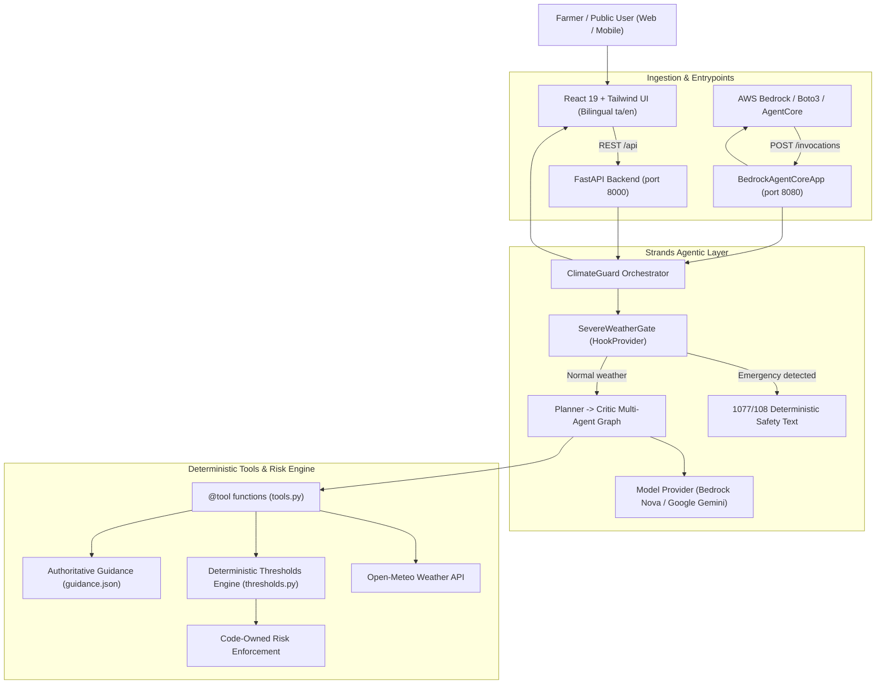

# ClimateGuard AI 🌾🌦️
> **Bilingual Climate Early-Warning & Agro-Advisory Agent for Tamil Nadu Farmers**  
> *தமிழ்நாடு விவசாயிகளுக்கான இருமொழி காலநிலை முன்னெச்சரிக்கை மற்றும் வழிகாட்டல் தளம்*

[](https://opensource.org/licenses/MIT)
[](https://www.python.org/)
[](https://fastapi.tiangolo.com/)
[](https://react.dev/)
[](https://tailwindcss.com/)
[](https://github.com/strands-ai/strands)
[](https://aws.amazon.com/bedrock/)

---

## 📌 Overview

**ClimateGuard AI** is a hyper-local, climate early-warning and decision-support system designed specifically for Tamil Nadu's agricultural communities. It bridges raw meteorological data and on-the-ground farming actions through **deterministic risk computation**, official IMD warning priority, life-safety emergency hooks, and an interactive **Strands Multi-Agent Graph** with support for both **Amazon Bedrock** and **Google Gemini** models.

Available completely in **Tamil (தமிழ்)** and **English**, the platform serves both **Farmers** (crop-specific hazard mitigation, spray windows, irrigation planning) and the **General Public** (heatwave, heavy rain, storm safety, and disaster relief guidance).

---

## ✨ Key Features

### 1. 🌾 Deterministic Agro-Climatic Risk Engine
- **Zero-Hallucination Risk Calculations**: Hazards are never estimated or invented by LLMs. Threshold evaluations for heat stress, excess rainfall, dry spells, and wind gusting run through verified agronomic rules ([`backend/config/thresholds.py`](backend/config/thresholds.py)).
- **Official IMD Priority Notice**: Official India Meteorological Department (IMD) alerts take absolute precedence.
- **Foliar Spray Advisory**: Computes safe spray windows based on wind speed (< 15 km/h) and rainfall probability without prescribing unverified chemical dosages.

### 2. 🤖 Strands Multi-Agent Graph (Planner $\to$ Critic Architecture)
- Built with the **Strands Agents SDK** following the AWS UG Madurai `strands-ship` kit patterns.
- **Code-Enforced Risk Integrity**: `assess_risk` evaluates Open-Meteo forecasts against thresholds; code re-enforces the deterministic risk level and never allows an LLM to override it.
- **Planner $\to$ Critic Multi-Agent Graph** ([`backend/agent/app.py`](backend/agent/app.py)): The planner drafts an `Answer`; the critic validates rules and checks valid citation IDs, triggering revisions if needed.
- **Authoritative Agronomic Corpus** ([`backend/agent/data/guidance.json`](backend/agent/data/guidance.json)): 10 verified safeguards sourced from TNAU Agritech Portal, IMD Pune, FAO-56, and TNSDMA with exact IDs, source URLs, and review dates.
- **Multi-Model Provider Support**: Supports `MODEL_PROVIDER=bedrock` (Amazon Nova / Claude) and `MODEL_PROVIDER=google` (Gemini 2.5 Flash), with automatic fallback to deterministic specialist execution when offline or unconfigured.

### 3. 🛡️ Life-Safety Emergency Gate Hook (`SevereWeatherGate`)
- Implemented as a **Strands HookProvider** using `BeforeNodeCallEvent` ([`backend/agent/safety.py`](backend/agent/safety.py)).
- Immediately detects severe weather and emergency keywords in English and Tamil:
  - *Cyclone / Gale*: புயல், சூறாவளி, cyclone, gale, landfall
  - *House Flood*: வீட்டுக்குள் வெள்ள நீர், flooded house, water inside house
  - *Lightning*: இடி மின்னல், thunderbolt, struck by lightning
  - *Heat Stroke & Fainting*: வெப்பத் தாக்கம், மயக்கம், sunstroke, unconscious
- **Instant Graph Cancellation**: Cancels LLM agent execution (`event.cancel_node`) and returns deterministic, code-owned bilingual safety guidance with immediate emergency escalation to **1077 (District Disaster Management)** and **108 (Ambulance)**. Zero LLM hallucinations during life-threatening events.

### 4. ⚡ Amazon Bedrock AgentCore Runtime Compatibility
- Native entrypoint ([`backend/agentcore_main.py`](backend/agentcore_main.py)) utilizing `BedrockAgentCoreApp` from `bedrock-agentcore`.
- Serves standard AgentCore ASGI microservice endpoints on port `8080`:
  - `POST /invocations`: Invokes the agent with `{ "prompt": "...", "district": "...", "crop": "..." }` and returns `{ "response": "...", "risk": "...", "language": "...", "tool_trace": [...], "provider": "bedrock-agentcore" }`.
  - `GET /ping`: Runtime container health check.
- Invocation helper script ([`backend/scripts/invoke_agentcore.py`](backend/scripts/invoke_agentcore.py)) utilizing `boto3.client("bedrock-agentcore")` with session ID generation and qualifier targeting.

### 5. 💧 7-Day Smart Irrigation Schedule
- Integrates FAO-56 Penman-Monteith reference evapotranspiration (ET0) and anticipated rainfall.
- Computes daily recommendations: **Irrigate**, **Skip**, or **Light Irrigation** with clear visual charts and net moisture balance (`Rain - ET0`).

### 6. 🔮 "What If?" Climate Scenario Simulator
- Interactive parametric stress-testing:
  - Simulate drought scenarios (`0` to `+14` consecutive dry days).
  - Simulate heat spikes (`+0°C` to `+5°C` temperature elevation).
- Real-time recalculation of composite hazard ratings with clear disclaimer: *"Scenario, not a forecast"*.

### 7. 🧪 Evals & Deterministic Baseline Benchmark
- **Single-Prompt Baseline** ([`backend/agent/baseline.py`](backend/agent/baseline.py)): Single agent with full guidance pasted in and zero tools/graph/hooks — the baseline to beat.
- **Deterministic Rubric Evaluator** ([`backend/agent/score.py`](backend/agent/score.py)): Scores answers on emergency recall (1077/108), risk correctness, banned advice regex detection, citation validity, and language script fidelity with zero model dependencies.

### 8. 🎨 Illustrated Vector Landscape Scene (`<WeatherScene />`)
- **Pure Vector Artwork (Inline SVG)**: Stylized Tamil Nadu landscape featuring layered Western Ghats hills, authentic temple Gopuram silhouette, terraced paddy fields with water reflections, swaying coconut palms, and banana plants.
- **Dynamic Hazard States**: Adapts palette and atmosphere for **Low (Sunrise)**, **Extreme Heat (Shimmer waves)**, **Heavy Rain (Animated streaks & flooded fields)**, **Drought (Cracked soil)**, and **Wind (Gust lines)**.
- **Accessible & Responsive**: WCAG AA compliant contrast scrim, min 32px Tamil typography, tab-visibility pause, and `prefers-reduced-motion` compliance.

---

## 🏗️ Architecture



---

## 📁 Repository Structure

```text
whether/
├── backend/
│   ├── agent/                      # Strands multi-agent system & tools
│   │   ├── data/
│   │   │   └── guidance.json       # Authoritative agronomic corpus (TNAU, IMD, FAO-56)
│   │   ├── app.py                  # Strands Planner -> Critic graph & CLI runner
│   │   ├── baseline.py             # Single-prompt benchmark baseline
│   │   ├── models.py               # Pydantic schemas & AgentTrace definitions
│   │   ├── orchestrator.py         # Multi-agent orchestrator & keyword router
│   │   ├── plan.py                 # Pydantic Answer & Critique schemas
│   │   ├── safety.py               # SevereWeatherGate HookProvider (1077/108)
│   │   ├── score.py                # Deterministic scoring & rubric evaluation
│   │   ├── sessions.py             # FileSessionManager & FarmerProfileStore
│   │   └── tools.py                # @tool get_forecast, assess_risk, crop_advice
│   │
│   ├── config/
│   │   ├── settings.py             # BaseSettings & environment configuration
│   │   └── thresholds.py           # Pure deterministic agromet thresholds
│   ├── data/                       # TN districts, crops, and emergency places
│   ├── services/
│   │   ├── risk_engine.py          # Hazard evaluation engine
│   │   └── weather_service.py      # Open-Meteo weather client
│   ├── scripts/
│   │   └── invoke_agentcore.py     # Boto3 client to invoke deployed Bedrock AgentCore
│   │
│   ├── agentcore_main.py           # Amazon Bedrock AgentCore runtime entrypoint (:8080)
│   ├── main.py                     # FastAPI backend application entrypoint (:8000)
│   ├── requirements.txt            # Pinned production Python dependencies
│   └── .env.example                # Backend environment template
│
├── frontend/
│   ├── src/
│   │   ├── components/             # WeatherScene, DashboardRiskHero, Irrigation, WhatIf
│   │   ├── context/                # Language (ta/en) & Dark Theme contexts
│   │   ├── locales/                # Localization dictionaries (en.json, ta.json)
│   │   ├── config.js               # API base URL with VITE_API_URL fallback
│   │   ├── App.jsx                 # Root application controller
│   │   └── main.jsx                # React DOM entrypoint
│   ├── package.json
│   ├── vite.config.js
│   └── .env.example                # Frontend environment template
│
├── .gitignore
└── README.md
```

---

## 🌐 Local Development

### Prerequisites
- **Python 3.11+**
- **Node.js 18+** & npm
- *(Optional)* **Google Gemini API Key** or **AWS Bedrock credentials** (deterministic mock fallback runs automatically when unconfigured)

---

### 1. Backend Setup (FastAPI Web Service)

```bash
# Navigate to backend directory
cd backend

# Create and activate virtual environment
python -m venv .venv
source .venv/bin/activate  # On Windows: .venv\Scripts\activate

# Install pinned production dependencies
pip install -r requirements.txt

# Configure environment variables
cp .env.example .env

# Start FastAPI backend server
uvicorn main:app --host 127.0.0.1 --port 8000 --reload
```

- FastAPI backend is available at `http://127.0.0.1:8000`
- Health check available at `http://127.0.0.1:8000/health`

---

### 2. Strands Agent CLI & Benchmark

You can execute the Strands agromet early-warning agent directly from the command line:

```bash
cd backend

# Run with a Tamil farmer question
python -m agent.app "நாளைக்கு மழை வருமா?"

# Run with an English question and specific district / crop
python -m agent.app "Should I irrigate today?" --district Thanjavur --crop paddy

# Run with structured JSON output
python -m agent.app "நாளைக்கு மழை வருமா?" --json

# Test the life-safety emergency gate (cancels LLM and returns fixed 1077/108 guidance)
python -m agent.app "வீட்டுக்குள் வெள்ள நீர் புகுந்துவிட்டது"

# Run the single-prompt baseline comparison
python -c "from agent import baseline; print(baseline.run('நாளைக்கு மழை வருமா?'))"

# Score an output deterministically
python -c "from agent import app, score; res = app.run({'text': 'நாளைக்கு மழை வருமா?'}); print(score.score({'text': 'நாளைக்கு மழை வருமா?', 'expected': {'risk': 'LOW'}}, res))"
```

---

### 3. Bedrock AgentCore Runtime (Local Testing)

```bash
cd backend

# Start the Bedrock AgentCore ASGI server on port 8080
python agentcore_main.py
```

In a separate terminal, test the standard `/ping` and `/invocations` endpoints:

```bash
# Health ping
curl http://localhost:8080/ping

# Invocations test with an English query
curl -X POST http://localhost:8080/invocations \
  -H "Content-Type: application/json" \
  -d '{"prompt":"Will it rain tomorrow in Madurai?"}'

# Invocations test with a plain Tamil query
curl -X POST http://localhost:8080/invocations \
  -H "Content-Type: application/json" \
  -d '{"prompt":"நாளைக்கு மழை வருமா?"}'
```

---

### 4. Frontend Setup

```bash
# Navigate to frontend directory
cd frontend

# Install packages
npm install

# Start Vite development server
npm run dev
```

Frontend is available at `http://127.0.0.1:5173`.

---

## 🚀 Deploy

ClimateGuard AI is architected for flexible deployment across multiple cloud platforms:
- **Frontend**: [Vercel](#1-frontend-deployment-vercel)
- **Backend API**: [Render](#2-backend-fastapi-deployment-render)
- **AI Agent Runtime**: [Amazon Bedrock AgentCore](#3-agent-runtime-deployment-amazon-bedrock-agentcore)

---

### 1. Frontend Deployment (Vercel)

1. In the [Vercel Dashboard](https://vercel.com/), click **Add New...** ➔ **Project**.
2. Import the `ClimateGuard-AI` repository.
3. Configure build settings:
   - **Framework Preset**: `Vite`
   - **Root Directory**: `frontend`
   - **Build Command**: `npm run build`
   - **Output Directory**: `dist`
4. Environment Variables:
   - `VITE_API_URL`: Full HTTPS URL of deployed backend (e.g. `https://climateguard-backend.onrender.com`).
5. Click **Deploy**.

---

### 2. Backend FastAPI Deployment (Render)

1. In the [Render Dashboard](https://dashboard.render.com/), click **New +** ➔ **Web Service**.
2. Select the `ClimateGuard-AI` repository.
3. Configuration:
   - **Name**: `climateguard-backend`
   - **Runtime**: `Python 3`
   - **Root Directory**: `backend`
   - **Build Command**: `pip install -r requirements.txt`
   - **Start Command**: `uvicorn main:app --host 0.0.0.0 --port $PORT`
   - **Health Check Path**: `/health`
4. Environment Variables:

| Environment Variable | Required | Description | Example Value |
| :--- | :---: | :--- | :--- |
| `ENVIRONMENT` | Yes | App runtime mode | `production` |
| `PORT` | Yes | Listening port (Render sets automatically) | `8000` |
| `MODEL_PROVIDER` | Yes | AI model provider (`google`, `bedrock`, or `mock`) | `google` |
| `GOOGLE_API_KEY` | Recommended | Gemini API key for live Strands agent | `AIzaSy...` |
| `GEMINI_MODEL_ID` | Optional | Gemini model version | `gemini-2.5-flash` |
| `CORS_ORIGINS` | Yes | Comma-separated allowed frontend origins | `https://climateguard-ai.vercel.app,http://localhost:5173` |

---

### 3. Agent Runtime Deployment (Amazon Bedrock AgentCore)

`backend/agentcore_main.py` is the production entrypoint for Amazon Bedrock AgentCore:

1. **Rename Entrypoint**: Rename `agentcore_main.py` to `main.py` in your AgentCore deployment container bundle.
2. **Container Port**: Expose port `8080`. The application automatically listens on `0.0.0.0:8080` inside Docker / microVM environments.
3. **Environment Variables**:
   - `MODEL_PROVIDER=bedrock`
   - `AWS_REGION=us-east-1`
   - `SHIP_MODEL=us.amazon.nova-2-lite-v1:0` (or `anthropic.claude-3-haiku-...`)
   - `AGENT_SESSION_DIR=/tmp/climateguard_sessions`
4. **Invocation Client**: Use [`backend/scripts/invoke_agentcore.py`](backend/scripts/invoke_agentcore.py) to send requests to your deployed AgentCore runtime ARN:
   ```bash
   export AGENTCORE_ARN="arn:aws:bedrock-agentcore:us-east-1:123456789012:agent-runtime/climateguard"
   python backend/scripts/invoke_agentcore.py "Will it rain tomorrow in Madurai?"
   ```

---

## 🔒 Security & Secrets Hygiene

- **Zero Secrets in Source Control**: All `.env` files and session caches (`.sessions/`) are strictly excluded in `.gitignore`.
- **Pure Environment Ingestion**: Keys (`GOOGLE_API_KEY`, `AWS_ACCESS_KEY_ID`, `AWS_SECRET_ACCESS_KEY`) and server parameters are read strictly through environment variables.
- **Dedicated Health Diagnostic**: `/health` and `/api/health` provide instant service diagnostics without leaking credentials.

---

## 📄 License

This project is licensed under the Apache-2.0 / MIT License.

---

## 👤 Author

Developed by **[SELVA-MEENAKSHI-K](https://github.com/SELVA-MEENAKSHI-K)**  
*ClimateGuard AI — Protecting livelihoods through intelligent, life-safe early warning.*
